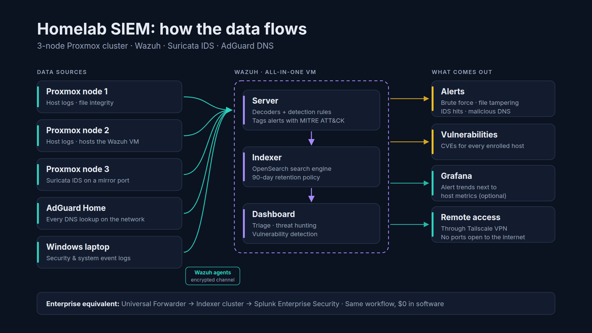
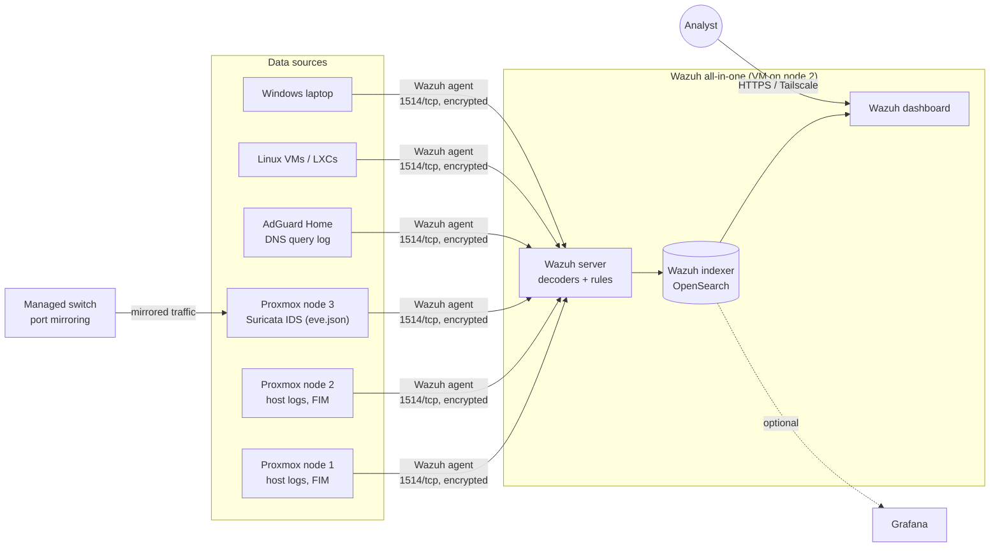

# Homelab SIEM: an enterprise-style SOC on a 3-node Proxmox cluster

A self-hosted **Security Information and Event Management (SIEM)** stack built with [Wazuh](https://wazuh.com). It collects host logs, network intrusion alerts and DNS activity from every machine in a home lab and turns them into searchable, MITRE ATT&CK-mapped alerts.

The goal is to practice the same workflow a corporate Security Operations Center (SOC) runs on Splunk Enterprise Security or Microsoft Sentinel, using only free, open-source tools on second-hand hardware.

> **Status:** 🚧 In progress. See the [build checklist](#build-checklist).

---

## Architecture



<details><summary>Diagram source (Mermaid)</summary>



</details>

## Enterprise equivalents

| Enterprise SOC (Splunk ES) | This homelab |
|---|---|
| Universal Forwarder | Wazuh agent |
| Indexer cluster | Wazuh indexer (OpenSearch), single node |
| Search head + ES app | Wazuh dashboard |
| Correlation searches → notable events | Rules + decoders → alerts (with MITRE ATT&CK tags) |
| Network IDS feed (e.g. Zeek/Suricata) | Suricata on a SPAN / mirror port |
| DNS logs | AdGuard Home query log |
| Vulnerability scanner | Wazuh vulnerability detection |
| File integrity monitoring (Tripwire etc.) | Wazuh FIM (syscheck) |
| Data retention policy | OpenSearch ISM policy (90 days) |

## What it detects (examples)

- SSH and Proxmox web UI **brute-force attempts**, by source IP
- **Changes to critical files** on the hypervisors (`/etc/pve`, `/etc/ssh`, `/etc/passwd`, …)
- **Suricata IDS alerts** from mirrored network traffic (ET Open ruleset)
- **DNS lookups** of blocked or known-malicious domains
- **Vulnerable packages** on every enrolled host
- **New users, sudo abuse and service changes** on Linux and Windows

## Repository layout

```
docs/                    Step-by-step build guide (start at 01)
config/agent/            Agent snippets (Suricata, AdGuard, FIM)
config/manager/rules/    Custom homelab detection rules
config/manager/lists/    Threat-intel CDB list template
config/indexer/          90-day retention policy
scripts/                 VM creation, agent install, pre-publish secret check
diagrams/                Architecture diagram source
.env.example             Every lab-specific value, as placeholders
```

## Build guide

| Step | Doc |
|---|---|
| 1 | [Plan and size the build](docs/01-plan-and-sizing.md) |
| 2 | [Create the VM and install Wazuh](docs/02-install-wazuh-server.md) |
| 3 | [Deploy agents (Linux, LXC, Windows)](docs/03-deploy-agents.md) |
| 4 | [Integrate Suricata, AdGuard and Proxmox logs](docs/04-integrations.md) |
| 5 | [Custom detections and safe attack simulation](docs/05-detections-and-testing.md) |
| 6 | [Optional: Wazuh alerts in Grafana](docs/06-grafana-optional.md) |
| 7 | [Operations: retention, backups, updates](docs/07-operations.md) |
| 8 | [Publishing this repo safely](docs/08-publishing-safely.md) |

## Build checklist

- [ ] Wazuh VM created and installed
- [ ] Default passwords rotated, firewall restricted to LAN
- [ ] Agents on all 3 Proxmox nodes
- [ ] Agents on VMs / LXCs and the Windows laptop
- [ ] Suricata alerts flowing (`rule.groups:suricata`)
- [ ] AdGuard DNS events flowing
- [ ] Custom rules loaded and tested
- [ ] 90-day retention policy applied
- [ ] Wazuh VM included in nightly Proxmox backups

## Hardware

Three second-hand Dell OptiPlex desktops running Proxmox VE: 64 GB RAM in total, a managed 8-port switch with port mirroring, and a dual-port Intel NIC on the sensor node. The Wazuh VM uses 4 vCPU, 8 GB RAM and 80 GB of disk.

## License

MIT. See [LICENSE](LICENSE). Wazuh is licensed under GPLv2 by Wazuh, Inc.; this repo contains only configuration and documentation.
